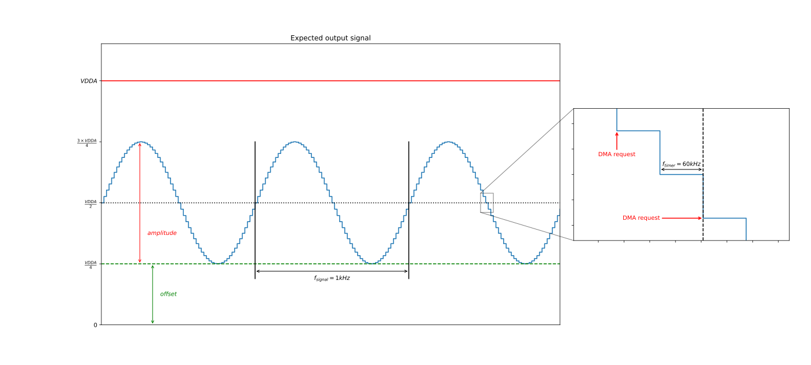
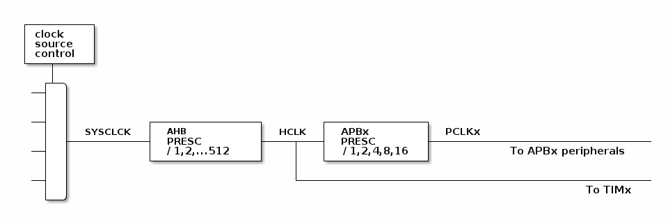

# __Example: *hal_dac_double_data_dma_tim*__

**Example version:** 2.0.0

How to use the DAC HAL API to generate a signal using the DMA double mode feature with a timer
trigger. This feature allows the MCU to decrease data transfer bandwidth by transferring two data blocks with a single DMA request,
every two TIM trigger.

## __1. Detailed scenario__

__Initialization phase__: At main program start, the `mx_system_init()` function is called. It initializes the peripherals, nonvolatile memory (such as flash memory, NVM, or external memories), MPU regions (if applicable), the system clock, and the SysTick.

The application executes the following __example steps__:

__Step 1__: The DAC, the DMA, and the TIM are initialized. The double data mode of the DAC enables the transfer of
two data blocks at each DMA request, one out of two triggers.

__Step 2__: Converts the data from millivolts to raw format because the DAC cannot directly handle millivolts format but only
raw format between 0 and the maximum DAC resolution.

__Step 3__: The DAC conversion is started using the DMA feature and the TIM is started to trigger the DAC conversion.
Every two TIM triggers, the DAC generates a DMA request to get two data blocks, one for the current trigger and the other the
following one.

__End of example__: The DAC conversion is repeated endlessly. Due to the DMA circular mode, every two TIM trigger,
the DAC generates a DMA request to get two new values to convert.
The example status is reported via the variable **`ExecStatus`**,
and the status led remains turned on in case of success.

The final output signal is a sine with a frequency of 1kHz, an amplitude of VDDA / 2 and an offset of VDDA / 4.

  

## __2. Example configuration__

__DAC__: The DAC uses the DMA double data mode feature to transfer data to be converted. So, the peripheral is configured with specific parameters:

  - Timer trigger.
  - 12-bit DAC data is used with right-alignment.
  - Output buffer enabled.
  - Circular buffer.
  - Double data mode: 2 data blocks are transferred every other trigger (one out of two).

__DMA__: Configured to transfer, on DAC request, two data from the memory to the DAC registers. Data is stored as a
buffer and the address of the element to be transferred is incremented after each transfer.

  *Note:* Data transferred to the DMA are in raw format to be used by the DAC. The macro LL_DAC_CALC_VOLTAGE_TO_DATA converts
  data in voltage units to raw format.

__TIM__: Configured to trigger the DAC with the following parameters:

  - Timer update event is used as an output trigger (TRGO).
  - Parameters have been chosen to get a SIG_FREQ = 1kHz signal in the output of the DAC.
  - The repetition counter (if present) is not used here.

The aim is to have a 1kHz sine waveform.

  The buffer that contains the sine waveform samples is BUFFER_SIZE_HALWORD long (60 samples).
  Therefore, each sample of the buffer signal should be converted with a frequency of:
    TRGO_freq = Sig_freq * BUFFER_SIZE = 60kHz

  *Note:* This frequency corresponds to the timer frequency.

  To get this 60kHz, the period is configured according to the formula below:
    TRGO_freq = Timer_clock_freq / ((PRESCALER_VALUE + 1) * (PERIOD_VALUE + 1))

  *Note:* The "+1" used in the formulas is needed because the registers' values start from 0.

  To get the better precision, the frequency is defined with a low PRESCALER_VALUE while the PERIOD_VALUE
  does not overflow the ARR register (16 bits / 32 bits).

  > PERIOD_VALUE = (Timer_clock_freq / (TRGO_freq * (PRESCALER_VALUE + 1))) - 1

## __3. Hardware environment and setup__

### __3.1. Generic Setup__

This section describes the hardware setup principles that apply to any board.

  
On STM32G5 series.

__Clock configuration for the timer counter__:

The AHB clock (HCLK) and system core clock are set to the system clock (SYSCLK), since prescalers are set to 1.

The timer input clock (Timer_clock_freq) is set to its respective APB clock (PCLK), since APB prescalers are set to 1.

    > Timer_clock_freq = PCLK = HCLK = SYSCLK (system clock) so Timer_clock_freq = HCLK in Hz

__Usual clock diagram of STM32G5xx MCUs' peripherals__:

<!---
@startuml
@startditaa{doc/stm32g5_peripherals_clocks.png}
 +---------+
 | clock   |
 | source  |
 | control |
 +---+-----+
 |
 ++-\
--+  |
  |  |
  |  |
--+  |           +---------------+        +--------------+
  |  |  SYSCLCK  |  AHB          |  HCLK  |  APBx        |  PCLKx
  |  +-----------+  PRESC        +----+---+  PRESC       +--------------------------------
--+  |           |  / 1,2,...512 |    |   | / 1,2,4,8,16 |          To APBx peripherals
  |  |           +---------------+    |   +--------------+
  |  |                                |
--+  |                                +---------------------------------------------------
  |  |                                                                          To TIMx
  +--/
@endditaa
@enduml
-->
  

  The HCLK is set to 280MHz.

  PERIOD_VALUE calculation with APB prescaler set to 1 and HCLK set to 280MHz:
  > PERIOD_VALUE = (Timer_clock_freq / (TRGO_freq * (PRESCALER_VALUE + 1))) - 1

  This equation can be resolved with:
  > PRESCALER_VALUE = 0
  >
  > PERIOD_VALUE = (280 MHz / 60kHz) - 1
  > PERIOD_VALUE = 4666 (rounded to the nearest integer)

### __3.2. Specific board setups__

This section describes the exact hardware configurations of your project.

  
On STM32G5 series.

  

    
On board NUCLEO-G564RE.

  |  MCU pin  |  Signal name  |  User Label   |
  |:---------:|:-------------:|:-------------:|
  |    PG3    |     GPIO      | MX_STATUS_LED |
  |    PA5    |   DAC2_OUT1   |       -       |

  

## __4. Troubleshooting__

Using the buffer feature of the DAC can impact its accuracy. To have further information about the DAC accuracy, you can
check the datasheet and the reference manual corresponding to your MCU.

## __5. See Also__

- [Application Note AN4566](https://www.st.com/content/ccc/resource/technical/document/application_note/6f/35/61/e9/8a/28/48/8c/DM00129215.pdf/files/DM00129215.pdf/jcr:content/translations/en.DM00129215.pdf): How to improve DAC performance in STM32 microcontrollers.

- [Application Note AN3126](https://www.st.com/content/ccc/resource/technical/document/application_note/05/fb/41/91/39/02/4d/1e/CD00259245.pdf/files/CD00259245.pdf/jcr:content/translations/en.CD00259245.pdf): How to use DAC for audio and waveform generation in STM32 products.

- [Application Note AN4013](https://www.st.com/content/ccc/resource/technical/document/application_note/54/0f/67/eb/47/34/45/40/DM00042534.pdf/files/DM00042534.pdf/jcr:content/translations/en.DM00042534.pdf): How to configure the timer.

You can also refer to these other examples:

- examples_hal_tim_timebase: demonstrates TIM peripheral using the timebase feature

The documentation of the drivers of the relevant STM32 series contains more detailed information.

For instance for the STM32C5 series: [HAL documentation](https://dev.st.com/stm32cube-docs/stm32c5xx-hal-drivers/latest/en/index.html).

More information about the STM32 ecosystem can be found in the [STM32 MCU Developer Zone](https://www.st.com/content/st_com/en/stm32-mcu-developer-zone/embedded-software.html).

## __6. License__

Copyright (c) 2026 STMicroelectronics.

This software is licensed under terms that can be found in the LICENSE file in the root directory
of this software component.
If no LICENSE file comes with this software, it is provided AS-IS.
