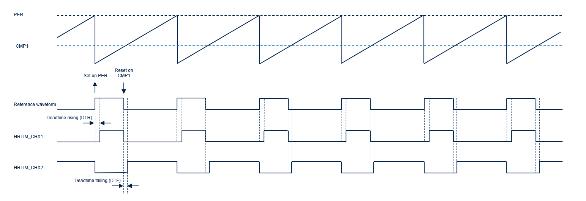
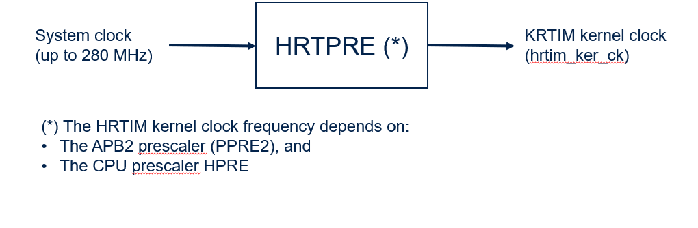

# __Example: *hal_hrtim_high_resolution_pwm*__

**Example version:** 2.0.0

How to generate high-resolution complementary PWM signals with deadtime using HRTIM.

This example initializes the HRTIM, launches periodic DLL calibration to guarantee high-resolution timing,
and then starts a pair of complementary PWM outputs.

## __1. Detailed scenario__

__Initialization phase__: At main program start, the `mx_system_init()` function is called. It initializes the peripherals, nonvolatile memory (such as flash memory, NVM, or external memories), MPU regions (if applicable), the system clock, and the SysTick.

The application executes the following __example steps__:

__Step 1__: Initializes HRTIM and configures the PWM outputs and timer resources.

__Step 2__: Starts periodic DLL calibration and waits for calibration completion.

__Step 3__: Enables PWM and complementary PWM outputs, then starts the HRTIM timer.

__Step 4__: Deinitializes the HRTIM instance before leaving the scenario.

__End of example__: If no error occurs, deinitialization is performed and the status LED remains ON.
If an error occurs, the status LED blinks continuously.

You can verify that the example runs properly via the status LED and the `ExecStatus` variable.

## __2. Example configuration__

### __2.1. IPs configuration__

This example uses the `HRTIM1` instance to generate complementary PWM outputs with deadtime insertion.

- Timer used: `HTIM_TIMx`
- Main output: `HRTM_CHx1`
- Complementary output: `HRTM_CHx2`
- Timer prescaler: `Set to get the best timer resolution to reach a 50 kHz frequency`
- Timer period: `Set to get A 50 kHz PWM signal`
- Compare value (CMP1): `Set to get a 5 us positive pulse on CHx1`
- Deadtime Prescaler: `Set to get the best deadtime resolution to reach a 200 ns deadtime`
- Deadtime rising edge: `Set to get a 200 ns deatime rising (DTR)`
- Deadtime falling edge: `Set to get a 100 ns deatime rising (DTF)`

The example also enables periodic DLL calibration and waits for completion before starting the PWM generation.

Diagram reference: [high_resolution_pwm.svg](doc/high_resolution_pwm.svg)

## __3. Hardware environment and setup__

### __3.1. Generic Setup__

Connect an oscilloscope to both HRTIM output pins and observe:

- `HRTIM1_CHx1` as the PWM output
- `HRTIM1_CHx2` as the complementary PWM output

During execution, verify that both outputs are complementary and that deadtime is inserted between transitions.

### __3.2. Specific board setups__

This section describes the exact hardware configurations of your project.

  
On STM32G5 series.

  

    
Common configuration.

  Clock distribution for HRTIM1:

   

Given the RCC configuration:

- System clock frequency (`sys_ck`) = `280 MHz`
- HRTIMx kernel clock frequency (`hrtim1_ker_ck`) = `280 MHz`
- HRTIMx timer X prescaler = `MUL8`

   - HRTIMx resolution = 1 / 8 * hrtimx_ker_ck = `446 ps`

Therefore:

- PWM base period = `(PER + 1) * HRTIMx resolution` = `20 us` = `20 000 000 ps`
- `PER`= (20000000 / 446) - 1 = `44842`

Reference output pulse widths:

- `PWMx`: `CMPx * HRTIMx resolution` = `5 us` = `5 000 000 ps`
- `CMPx`= 5000000 / 446  = `11210`

Deadtime:

- HRTIMx clock period (`tHRTIM`) = 1 / `hrtim1_ker_ck`
- Deadtime prescaler = `DIV8`

   - Deadtime resolution = `tHRTIM` / 8 = `446 ps`

Therefore:

- `Deadtime rising`: `DTR * Deadtime resolution` = `200 ns` =  = `200 000 ps`
- `DTR` = 200000 / 446  = `448`
- `Deadtime falling`: `DTF * Deadtime resolution` = `100 ns` =  = `100 000 ps`
- `DTR` = 100000 / 446  = `7222`

  

  

    
On board NUCLEO-G564RE.

  |  MCU pin  |  Signal name  |  User Label   |
  |:---------:|:-------------:|:-------------:|
  |    PG3    |     GPIO      | MX_STATUS_LED |
  |    PB5    |  HRTIM1_CHA1  |       -       |
  |    PB6    |  HRTIM1_CHA2  |       -       |

  

## __4. Troubleshooting__

Find below the points of attention for this specific example.

__No PWM signal visible on outputs__

- Check that HRTIM1 clock is enabled.
- Verify GPIO alternate-function configuration.
- Confirm outputs are enabled with `HAL_HRTIM_OUT_Enable()` before starting the timer.

__Complementary output behavior is incorrect__

- Verify that both outputs (`CHx1` and `CHx2`) are enabled.
- Check deadtime configuration values (rising and falling).
- Confirm that timer X compare and period values are consistent with expected duty cycle.

__PWM start fails after initialization__

- Ensure DLL calibration is started and completed successfully before enabling outputs.
- Check return status of `HAL_HRTIM_StartPeriodicDLLCalibration()` and `HAL_HRTIM_PollForDLLCalibration()`.
- Verify timeout value is sufficient for your clock settings.

## __5. See Also__

This [HRTIM cookbook (ref. AN4539)](https://www.st.com/content/ccc/resource/technical/document/application_note/13/d6/48/9d/11/11/4c/08/DM00121475.pdf/files/DM00121475.pdf/jcr:content/translations/en.DM00121475.pdf) presents an overview of the HRTIM peripheral and related examples.

The documentation of the drivers of the relevant STM32 series contains more detailed information.

For instance for the STM32C5 series: [HAL documentation](https://dev.st.com/stm32cube-docs/stm32c5xx-hal-drivers/latest/en/index.html).

More information about the STM32 ecosystem can be found in the [STM32 MCU Developer Zone](https://www.st.com/content/st_com/en/stm32-mcu-developer-zone/embedded-software.html).

## __6. License__

Copyright (c) 2026 STMicroelectronics.

This software is licensed under terms that can be found in the LICENSE file in the root directory
of this software component.
If no LICENSE file comes with this software, it is provided AS-IS.
