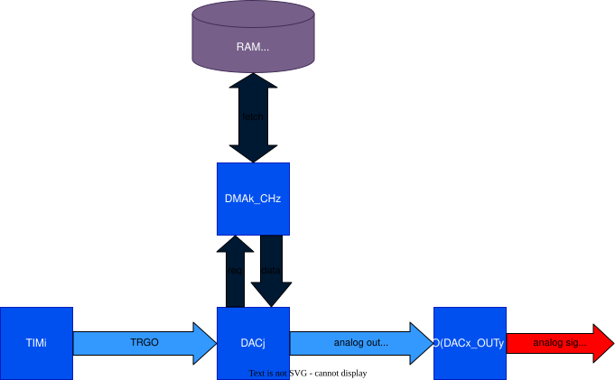
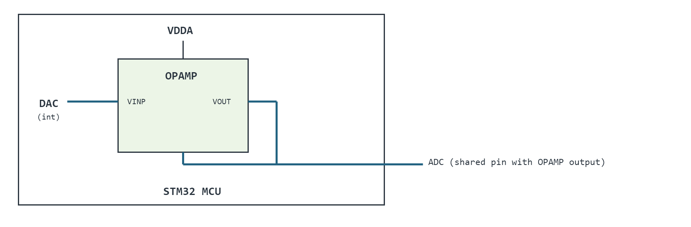

# __Example: *hal_opamp_interconnect_adc_dac*__

**Example version:** 2.0.0

[](https://dev.st.com/stm32cube-docs/examples/arch-v1/en/index.html "An offline version is also available in the STM32Cube firmware package.")

How to use the OPAMP with internal connections to other analog peripherals DAC and ADC.


## __1. Detailed scenario__

This example connects three peripherals: an OPAMP, a DAC, and an ADC (referred to below as the OPAMP, the DAC, and the ADC).

The DAC output is internally connected to the OPAMP non-inverting input, while the OPAMP output and the ADC input share the same GPIO pin, so no external jumper is required.

__Initialization phase__: At the beginning of the `main()` function, the `mx_system_init()` function is called to
initialize the peripherals, the Flash interface, the system clock, and the SysTick.

The application executes the following __example steps__:

__Step 1__: Configures the DAC to continuously generate a signal on the OPAMP non-inverting input.

__Step 2__: Configures the OPAMP in follower mode, with its non-inverting input internally connected to the DAC and its output connected to the ADC input through a shared GPIO pin.

__Step 3__: Configures the ADC to acquire the OPAMP output.

__Step 4__: Starts the DAC, the OPAMP, and the ADC. The DAC updates its output and the ADC samples the resulting OPAMP output, using a software-triggered conversion in polling mode.

__End of example__: The example status is reported via the variable **`ExecStatus`**, and the status LED remains
turned on in case of success.

You can verify that the example runs properly via the status LED and the `ExecStatus`, `DacRawData` and `AdcRawData`
variables.

If you enable `USE_TRACE`, you can follow these execution steps in the terminal logs:

```text
[INFO] Step 1: DAC configuration COMPLETED.
[INFO] Step 2: OPAMP configuration COMPLETED.
[INFO] Step 3: ADC configuration COMPLETED.
[INFO] Step 4: DAC, OPAMP and ADC started. DacRawData = 2047  AdcRawData = 2047
...
```


## __2. Example configuration__

[](https://dev.st.com/stm32cube-docs/examples/arch-v1/en/configure/config_toc.html "An offline version is also available in the STM32Cube firmware package.")

### __2.1. Block Diagram__



### __2.2. IPs configuration__

__OPAMP__: configured in follower mode (unity gain).

  - Non-inverting input: connected internally to the DAC output.
  - Output: connected to the ADC input through a shared GPIO pin.

__DAC__: outputs a fixed mid-scale voltage (VDDA/2) on the OPAMP non-inverting input, with no trigger needed.

__ADC__: acquires the OPAMP output with a single, software-triggered conversion in polling mode.


## __3. Hardware environment and setup__

### __3.1. Generic Setup__

There is no external jumper needed to run this example. The DAC output is internally connected to the OPAMP input,
while the OPAMP output and ADC input share the same GPIO pin.

<!--
@startuml
@startditaa{doc/ASCII_ditaa_interconnect.png}
            /-------------------------------\
            |             VDDA              |
            |             -+-               |
            |              |                |
            |       /------+------\         |
            |       |    OPAMP    |         |
            |       |             |         |
            |   DAC-+ VINP        |         |
            |  (int)|        VOUT +---+     |
            |       |             |   |     |
            |       \------+------/   |     |
            |              |          |     |
            |              +----------+-----+--- ADC (shared pin with OPAMP output)
            |                                |
            |          STM32 MCU            |
            \-------------------------------/
@endditaa
@enduml
-->



### __3.2. Specific board setups__

This section describes the exact hardware configurations of your project.

<details>
  <summary>On STM32G5 series.</summary>
  <details>
    <summary>On board NUCLEO-G564RE.</summary>

  |  MCU pin  |  Signal name  |  User Label   |
  |:---------:|:-------------:|:-------------:|
  |    PG3    |     GPIO      | MX_STATUS_LED |
  |    PA2    |   USART2_TX   |       -       |
  |    PB1    |  OPAMP3_VOUT  |       -       |

  </details>
</details>


## __4. Troubleshooting__

[](https://dev.st.com/stm32cube-docs/examples/arch-v1/en/debug/debug_toc.html "An offline version is also available in the STM32Cube firmware package.")

Find below the points of attention for this specific example.

__Calibration__: This example uses factory trimming values for the OPAMP. However, calibration can be performed
to adjust the values to your working environment.

__Peripheral routing__: Not all STM32 series/lines offer the same routing options between the OPAMP, DAC and ADC.
Refer to the datasheet and reference manual of your device before adapting this example to another board.

__Voltage Range__: The OPAMP delivers a voltage between 0V and VDDA (not always 3.3V). Be careful when using
1.8V boards.


## __5. See Also__

[](https://dev.st.com/stm32cube-docs/examples/arch-v1/en/more/more_toc.html "An offline version is also available in the STM32Cube firmware package.")

This [application note](https://www.st.com/resource/en/application_note/an5306-operational-amplifier-opamp-usage-in-stm32g4-series-stmicroelectronics.pdf)
explains further the OPAMP application for analog circuits.

You can also refer to these other examples:

  - `hal_opamp_follower`
  - `hal_opamp_calibration`
  - `hal_adc_single_conv_trigger_sw_polling`
  - `hal_dac_simple_conversion`

More information about the STM32 ecosystem can be found in the [STM32 MCU Developer Zone](https://www.st.com/content/st_com/en/stm32-mcu-developer-zone/embedded-software.html).


## __6. License__

Copyright (c) 2026 STMicroelectronics.

This software is licensed under terms that can be found in the LICENSE file in the root directory
of this software component.
If no LICENSE file comes with this software, it is provided AS-IS.
