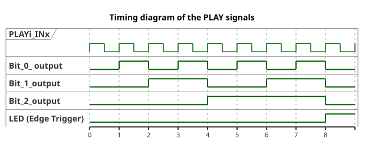
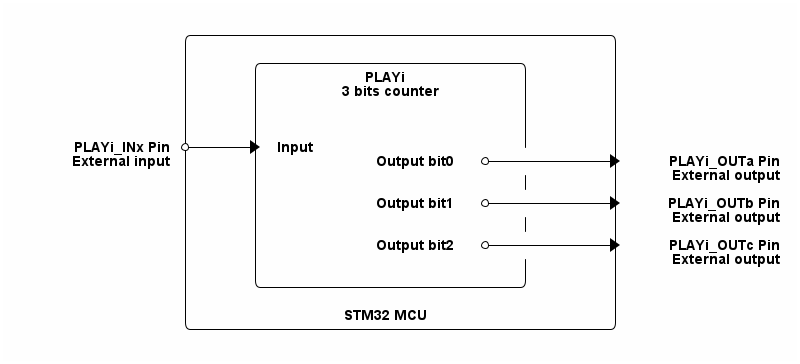

# __Example: *hal_play_counter_3bits*__

**Example version:** 2.0.0

[](https://dev.st.com/stm32cube-docs/examples/arch-v1/en/index.html "An offline version is also available in the STM32Cube firmware package.")

How to configure the PLAY peripheral to act as a 3 bits counter. This example shows how to use the HAL drivers to configure the PLAY peripheral to perform a counter using interconnected Lookup Tables (LUTs) and the PLAY input signal.


## __1. Detailed scenario__

__Initialization phase__: At main program start, the `mx_system_init()` function is called. It initializes the peripherals, nonvolatile memory (such as flash memory, NVM, or external memories), MPU regions (if applicable), the system clock, and the SysTick.

The application executes the following __example steps__:

__Step 1__: Configures, initializes, and starts the PLAY instance.

__Step 2__: The user can change the PLAYi_INx input signal to see how the outputs changes accordingly.
            The PLAY peripheral counts with 3 bits on each rising edge of the PLAYi_INx input signal. Each bit is output on a separate PLAYi_OUTy signal.
            When the counter reaches the maximum value, it wraps around to zero and triggers an interrupt that toggles the LED on the board to indicate the counter overflow.
            Returns to step 2 indefinitely if no error occurs.

__End of example__: The example run indefinitely or until an error occurs.

You can verify that the example runs properly via the status LED and the `ExecStatus` variable.

If you enable `USE_TRACE`, you can follow these execution steps in the terminal logs:

```text
[INFO] Step 1: Device initialization COMPLETED.
[INFO] Step 2: Edge trigger: counter reset to 0 (LUT2 output falling edge).
...
```



You can also visualize the counter behavior in the *Logisim-evolution* circuit file: [STMicroelectronics_3_bit_counter_logisim_evolution.circ](doc/STMicroelectronics_counter_3bits_logisim_evolution.circ).

Download *Logisim-evolution* from [GitHub](https://github.com/logisim-evolution/logisim-evolution).


## __2. Example configuration__

[](https://dev.st.com/stm32cube-docs/examples/arch-v1/en/configure/config_toc.html "An offline version is also available in the STM32Cube firmware package.")

The PLAY peripheral is configured to count with 3 bits, using the PLAYi_INx input signal as a clock source. The PLAYi_OUTy output signals are used to output the counter bits.
The external input signal is connected to the PLAYi_INx pin, which is configured to trigger the counter on its rising edge.
Three lookup tables (LUTs) are used to implement the counter logic. Each LUT is configured to use its own registered output and that of the preceding LUT, with the PLAYi_INy input signal serving as the clock gate.
The PLAYi_OUTy output signals are connected to each LUT and is used to output each bit of the counter.
The PLAY peripheral is configured to generate an interrupt when the counter reset to zero (falling edge of most significant bit's LUT), which is used to toggle the status LED on the board.


## __3. Hardware environment and setup__

### __3.1. Generic Setup__

This section describes the hardware setup principles that apply to any board.

<!--
@startuml
@startditaa{doc/STMicroelectronics_example_hal_play_counter_3bits.png}
                /------------------------------------------\
                |                                          |
                |      /--------------------------\        |
                |      |          PLAYi           |        |
                |      |      3 bits counter      |        |
                |      |                          |        |
                |      |                          |        |
                |      |                          |        |
  PLAYi_INx Pin *----+-> Input                    |        |
 External input |      |          Output bit0 *----------+->* PLAYi_OUTa Pin
                |      |                          |        | External output
                |      |                          |        |
                |      |          Output bit1 *----------+->* PLAYi_OUTb Pin
                |      |                          |        | External output
                |      |                          |        |
                |      |          Output bit2 *----------+->* PLAYi_OUTc Pin
                |      |                          |        | External output
                |      |                          |        |
                |      \--------------------------/        |
                |                                          |
                |               STM32 MCU                  |
                \------------------------------------------/
@endditaa
@enduml
-->



### __3.2. Specific board setups__

This section describes the exact hardware configurations of your project.

<details>
  <summary>On STM32G5 series.</summary>
  <details>
    <summary>On board NUCLEO-G564RE.</summary>

  |  MCU pin  |  Signal name  |  User Label   |
  |:---------:|:-------------:|:-------------:|
  |    PG3    |     GPIO      | MX_STATUS_LED |
  |   PC14    | RCC_OSC32_IN  |       -       |
  |   PC15    | RCC_OSC32_OUT |       -       |
  |    PA2    |   USART2_TX   |       -       |
  |   PC13    |   PLAY1_IN4   |       -       |
  |   PD11    |  PLAY1_OUT0   |       -       |
  |   PD12    |  PLAY1_OUT1   |       -       |
  |   PB14    |  PLAY1_OUT2   |       -       |

  </details>
</details>


## __4. Troubleshooting__

[](https://dev.st.com/stm32cube-docs/examples/arch-v1/en/debug/debug_toc.html "An offline version is also available in the STM32Cube firmware package.")

Find below the points of attention for this specific example.

__Pins__: Make sure that the user signals are connected to the correct pin of the STM32 MCU.


## __5. See Also__

[](https://dev.st.com/stm32cube-docs/examples/arch-v1/en/more/more_toc.html "An offline version is also available in the STM32Cube firmware package.")

The documentation of the drivers of the relevant STM32 series contains more detailed information.

More information about the STM32 ecosystem can be found in the [STM32 MCU Developer Zone](https://www.st.com/content/st_com/en/stm32-mcu-developer-zone/embedded-software.html).


## __6. License__

Copyright (c) 2026 STMicroelectronics.

This software is licensed under terms that can be found in the LICENSE file in the root directory
of this software component.
If no LICENSE file comes with this software, it is provided AS-IS.
