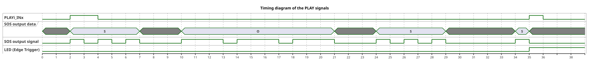
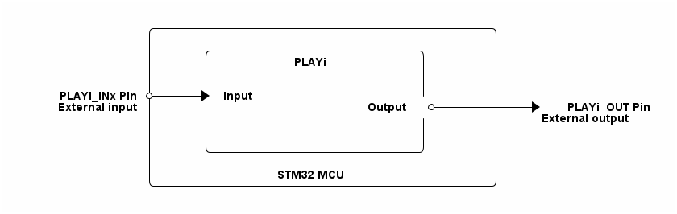

# __Example: *hal_play_emergency_alarm*__

**Example version:** 2.0.0

[](https://dev.st.com/stm32cube-docs/examples/arch-v1/en/index.html "An offline version is also available in the STM32Cube firmware package.")

How to configure and use the HAL PLAY driver to implement a complex logic with multiple interconnected lookup tables. This examples demonstrates an emergency alarm system that is outputting a morse SOS signal without using the CPU, in STOP mode.


## __1. Detailed scenario__

__Initialization phase__: At main program start, the `mx_system_init()` function is called. It initializes the peripherals, nonvolatile memory (such as flash memory, NVM, or external memories), MPU regions (if applicable), the system clock, and the SysTick.

The application executes the following __example steps__:

__Step 1__: Configures, initializes, and starts the PLAY instance.

__Step 2__: The system enters STOP mode to demonstrate that the alarm signal is fully handled by the PLAY hardware.
            During STOP mode, the PLAY LUT output flags are not functional.
            To wakeup the system, this example configures the PLAY EXTI output so that the falling edge of LUT 15
            will trigger the EXTI, waking up the system.

__Step 3__: The user can change the PLAYi_INx input signal to trigger the alarm signal.
            As the PLAY peripheral handles the alarm signal, the application does not need to do anything in this step.
            When the user changes the input signal a second time, the PLAY peripheral will stop the alarm signal.
            The alarm stop will trigger a LUT falling edge interrupt, which will wake the system.
            The application will then turn the LED on for one second to indicate that the alarm has been stopped.
            Returns to step 2 indefinitely if no error occurs.

__End of example__: The example run indefinitely or until an error occurs.

You can verify that the example runs properly via the status LED and the `ExecStatus` variable.

If you enable `USE_TRACE`, you can follow these execution steps in the terminal logs:

```text
[INFO] Step 1: Device initialization COMPLETED.
[INFO] Step 2: Enter STOP Mode.
[INFO] Step 3: Alarm stopped by user. WakeUp detection and clock re-configuration.
[INFO] Step 2: Enter STOP Mode.
[INFO] Step 3: Alarm stopped by user. WakeUp detection and clock re-configuration.
...
```



You can also visualize the counter behavior in the *Logisim-evolution* circuit file: [STMicroelectronics_emergency_alarm_logisim_evolution.circ](doc/STMicroelectronics_emergency_alarm_logisim_evolution.circ).

Download *Logisim-evolution* from [GitHub](https://github.com/logisim-evolution/logisim-evolution).


## __2. Example configuration__

[](https://dev.st.com/stm32cube-docs/examples/arch-v1/en/configure/config_toc.html "An offline version is also available in the STM32Cube firmware package.")

The PLAY peripheral is configured to output a morse SOS signal (three short signals, three long signals, three short signals) on the PLAYi_OUTx output pins. This sequence operates with the MCU in stop mode.
This PLAY configuration uses 13 interconnected lookup tables (LUTs) to generate the morse SOS signal. The configuration can be visualized in the *Logisim-evolution* circuit file: [STMicroelectronics_emergency_alarm_logisim_evolution.circ](doc/STMicroelectronics_emergency_alarm_logisim_evolution.circ).
The PLAYi_INx input signal is used to trigger and stop the alarm signal.
When the alarm stops, the PLAY peripheral generates a falling edge on the PLAY output pin connected to the EXTI, which will wake the system from STOP mode.


## __3. Hardware environment and setup__

### __3.1. Generic Setup__

This section describes the hardware setup principles that apply to any board.

<!--
@startuml
@startditaa{doc/STMicroelectronics_example_hal_play_emergency_alarm.png}
                /------------------------------------------\
                |                                          |
                |      /--------------------------\        |
                |      |          PLAYi           |        |
                |      |                          |        |
                |      |                          |        |
  PLAYi_INx Pin *----+-> Input                    |        |
 External input |      |                   Output  *----------+->* PLAYi_OUT Pin
                |      |                          |        | External output
                |      |                          |        |
                |      |                          |        |
                |      \--------------------------/        |
                |                                          |
                |               STM32 MCU                  |
                \------------------------------------------/
@endditaa
@enduml
-->



### __3.2. Specific board setups__

This section describes the exact hardware configurations of your project.

<details>
  <summary>On STM32G5 series.</summary>
  <details>
    <summary>On board NUCLEO-G564RE.</summary>

  |  MCU pin  |  Signal name  |  User Label   |
  |:---------:|:-------------:|:-------------:|
  |    PG3    |     GPIO      | MX_STATUS_LED |
  |   PC14    | RCC_OSC32_IN  |       -       |
  |   PC15    | RCC_OSC32_OUT |       -       |
  |    PA2    |   USART2_TX   |       -       |
  |   PC13    |   PLAY1_IN4   |       -       |
  |   PD11    |  PLAY1_OUT0   |       -       |

  </details>
</details>


## __4. Troubleshooting__

[](https://dev.st.com/stm32cube-docs/examples/arch-v1/en/debug/debug_toc.html "An offline version is also available in the STM32Cube firmware package.")

Find below the points of attention for this specific example.

__Pins__: Make sure that the user signals are connected to the correct pin of the STM32 MCU.


## __5. See Also__

[](https://dev.st.com/stm32cube-docs/examples/arch-v1/en/more/more_toc.html "An offline version is also available in the STM32Cube firmware package.")

The documentation of the drivers of the relevant STM32 series contains more detailed information.

More information about the STM32 ecosystem can be found in the [STM32 MCU Developer Zone](https://www.st.com/content/st_com/en/stm32-mcu-developer-zone/embedded-software.html).


## __6. License__

Copyright (c) 2026 STMicroelectronics.

This software is licensed under terms that can be found in the LICENSE file in the root directory
of this software component.
If no LICENSE file comes with this software, it is provided AS-IS.
