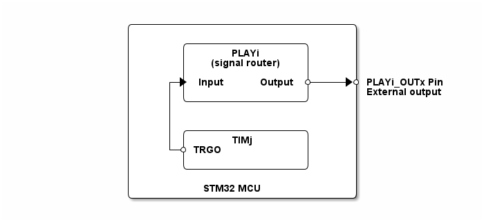

# __Example: *hal_play_signal_routing*__

**Example version:** 2.0.0

[](https://dev.st.com/stm32cube-docs/examples/arch-v1/en/index.html "An offline version is also available in the STM32Cube firmware package.")

How to configure the PLAY peripheral to act as signal router. This example shows how to use the HAL drivers to configure the PLAY peripheral to perform a signal router from a TIM internal signal to an external GPIO.


## __1. Detailed scenario__

__Initialization phase__: At main program start, the `mx_system_init()` function is called. It initializes the peripherals, nonvolatile memory (such as flash memory, NVM, or external memories), MPU regions (if applicable), the system clock, and the SysTick.

The application executes the following __example steps__:

__Step 1__: Configures, initializes, and starts the PLAY & TIM peripherals.

__Step 2__: Toggles the TIM TRGO internal signal each second.
            The signal is routed to the PLAYi_INx input signal, which is output on the PLAYi_OUTy signal.
            Returns to step 2 indefinitely if no error occurs.

__End of example__: The example run indefinitely or until an error occurs.

You can verify that the example runs properly via the status LED and the `ExecStatus` variable.

If you enable `USE_TRACE`, you can follow these execution steps in the terminal logs:

```text
[INFO] Step 1: Initialization and configuration of the PLAY & TIM peripherals COMPLETED.
[INFO] Step 2: TIM TRGO toggled.
[INFO] Step 2: TIM TRGO toggled.
...
```


## __2. Example configuration__

[](https://dev.st.com/stm32cube-docs/examples/arch-v1/en/configure/config_toc.html "An offline version is also available in the STM32Cube firmware package.")

The PLAY peripheral is configured to route the TIM TRGO internal signal to the PLAYi_OUTx output pin. The PLAYi_INx input signal is used to trigger the routing.
One lookup table (LUT) is used to route the TIM TRGO signal to the PLAYi_OUTx output.
The PLAYi_OUTx output signal is connected to an external GPIO pin.


## __3. Hardware environment and setup__

### __3.1. Generic Setup__

This section describes the hardware setup principles that apply to any board.

<!--
@startuml
@startditaa{doc/STMicroelectronics_example_hal_play_signal_routing.png}
                /--------------------------------\
                |                                |
                |       /-----------------\      |
                |       |      PLAYi      |      |
                |       | (signal router) |      |
                |       |                 |      |
                |     +-> Input    Output *---+->* PLAYi_OUTx Pin
                |     | |                 |      | External output
                |     | \-----------------/      |
                |     |                          |
                |     |                          |
                |     | /-----------------\      |
                |     | |      TIMj       |      |
                |     +-* TRGO            |      |
                |       |                 |      |
                |       \-----------------/      |
                |                                |
                |          STM32 MCU             |
                \--------------------------------/
@endditaa
@enduml
-->



### __3.2. Specific board setups__

This section describes the exact hardware configurations of your project.

<details>
  <summary>On STM32G5 series.</summary>
  <details>
    <summary>On board NUCLEO-G564RE.</summary>

  |  MCU pin  |  Signal name  |  User Label   |
  |:---------:|:-------------:|:-------------:|
  |    PG3    |     GPIO      | MX_STATUS_LED |
  |   PC14    | RCC_OSC32_IN  |       -       |
  |   PC15    | RCC_OSC32_OUT |       -       |
  |    PA2    |   USART2_TX   |       -       |
  |   PD11    |  PLAY1_OUT0   |       -       |

  </details>
</details>


## __4. Troubleshooting__

[](https://dev.st.com/stm32cube-docs/examples/arch-v1/en/debug/debug_toc.html "An offline version is also available in the STM32Cube firmware package.")

Find below the points of attention for this specific example.

__Pins__: Make sure that the user signals are connected to the correct pin of the STM32 MCU.


## __5. See Also__

[](https://dev.st.com/stm32cube-docs/examples/arch-v1/en/more/more_toc.html "An offline version is also available in the STM32Cube firmware package.")

The documentation of the drivers of the relevant STM32 series contains more detailed information.

More information about the STM32 ecosystem can be found in the [STM32 MCU Developer Zone](https://www.st.com/content/st_com/en/stm32-mcu-developer-zone/embedded-software.html).


## __6. License__

Copyright (c) 2026 STMicroelectronics.

This software is licensed under terms that can be found in the LICENSE file in the root directory
of this software component.
If no LICENSE file comes with this software, it is provided AS-IS.
