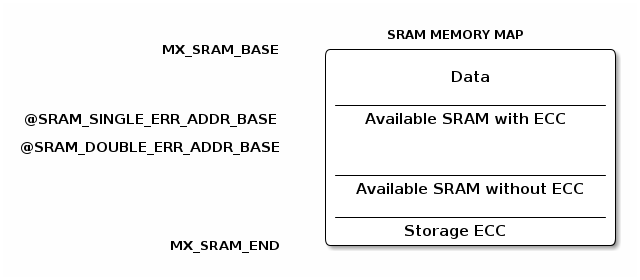

# __Example: *hal_ramcfg_ecc_error_detection*__

**Example version:** 2.0.6

[](https://dev.st.com/stm32cube-docs/examples/arch-v1/en/index.html "An offline version is also available in the Cube Firmware package.")

How to configure and use the RAMCFG HAL APIs to demonstrate the RAMCFG ECC (Error Code Correction) monitoring in interrupt mode.
This monitoring supports the single error detection and correction and double error detection.


## __1. Detailed scenario__

__Initialization phase__: At main program start, the `mx_system_init()` function is called. It initializes the peripherals, nonvolatile memory (such as flash memory, NVM, or external memories), MPU regions (if applicable), the system clock, and the SysTick.


The application executes the following __example steps__:

- __Step 1__: configures and initializes the RAMCFG instance and the NVIC.
- __Step 2__: writes known data to the selected SRAM memory with ECC enabled, then disables ECC to inject one single-bit error and one double-bit error. It then enables ECC monitoring and the configured ECC interrupts.
- __Step 3__: reads the word containing the single-bit error. The ECC interrupt calls the user callback, which verifies that the error was corrected, records its address, and sets the single-error-detected flag. The application waits for this flag before continuing.
- __Step 4__: reads the word containing the double-bit error. The ECC NMI calls the user callback, which verifies that the error was not corrected, records its address, and sets the double-error-detected flag. The application waits for this flag before continuing.
- __Step 5__: deinitializes the RAMCFG instance before leaving the scenario.
__End of example__: after step 5, the example is completed. You can check its status via the variable ExecStatus and the **status LED** remains turned on in case of success.


If you enable **`USE_TRACE`**, you can follow these steps, in the nominal case of execution, in the terminal logs:

```text
[INFO] Step 1: Device initialization COMPLETED.
[INFO] Step 2: One ECC single error and one ECC double error injected.
[INFO] Step 3: Single ECC detected and corrected at address 0xXXXXXXXX
[INFO] Step 4: Double ECC detected and not corrected at address 0xXXXXXXXX
[INFO] Step 5: de-init.
```

During Steps 3 and 4, the reads use a volatile access so that they are performed even when compiler optimization is enabled. The callback retrieves the error type, correction status, and address with `HAL_RAMCFG_ECC_GetInfo()`. The application only completes when it has received both expected events: a corrected single ECC error and a non-corrected double ECC error. The reported addresses depend on the selected SRAM memory area.


## __2. Example configuration__

[](https://dev.st.com/stm32cube-docs/examples/arch-v1/en/configure/config_toc.html "An offline version is also available in the STM32Cube firmware package.")

This example demonstrates the following peripheral:

__RAMCFG__:
RAMCFG is the abbreviation of RAM configuration controller. In this example, the RAMCFG interrupt is configured and enabled in the NVIC to handle:

  - Single errors detection and correction event.
  - Double errors detection event.


## __3. Hardware environment and setup__

### __3.1. Generic Setup__

<details>
<summary> Expand this tab to visualize the architecture of the SRAM memory map.</summary>

<!--
@startuml
@startditaa{doc/sram_memory_map.png}
                                    SRAM MEMORY MAP
              MX_SRAM_BASE    /----------------------------\
                              |                            |
                              |            Data            |
                              |                            |
                              |----------------------------|
@SRAM_SINGLE_ERR_ADDR_BASE    |  Available SRAM with ECC   |
                              |                            |
@SRAM_DOUBLE_ERR_ADDR_BASE    |                            |
                              |                            |
                              |----------------------------|
                              | Available SRAM without ECC |
                              |                            |
                              |----------------------------|
                              |       Storage ECC          |
               MX_SRAM_END    \----------------------------/
@endditaa
@endumldd
-->

> **_NOTE:_** The SRAM_SINGLE_ERR_ADDR_BASE and SRAM_DOUBLE_ERR_ADDR_BASE must support the ECC.


</details>

### __3.2. Specific board setups__

<details>
  <summary>On STM32G5 series.</summary>
  <details>
    <summary>On board NUCLEO-G564RE.</summary>

  |  MCU pin  |  Signal name  |  User Label   |
  |:---------:|:-------------:|:-------------:|
  |    PG3    |     GPIO      | MX_STATUS_LED |
  |    PA2    |   USART2_TX   |       -       |

  </details>
</details>
</details>


## __4. Troubleshooting__

[](https://dev.st.com/stm32cube-docs/examples/arch-v1/en/debug/debug_toc.html "An offline version is also available in the STM32Cube firmware package.")

Here are some important points for this example:

__Correction__: Only single errors are corrected. Double errors are only detected.


## __5. See Also__

[](https://dev.st.com/stm32cube-docs/examples/arch-v1/en/more/more_toc.html "An offline version is also available in the STM32Cube firmware package.")

You can also refer to these other examples demonstrating how to secure access violation SRAM or with different HAL RAMCFG setups:

- example_hal_rif_internal_sram_protection
- example_hal_ramcfg_write_protection

The documentation of the drivers of the relevant STM32 series contains more detailed information.

For instance for the STM32C5 series: [HAL documentation](https://dev.st.com/stm32cube-docs/stm32c5xx-hal-drivers/latest/en/index.html).

More information about the STM32 ecosystem can be found in the [STM32 MCU Developer Zone](https://www.st.com/content/st_com/en/stm32-mcu-developer-zone/embedded-software.html).


## __6. License__

Copyright (c) 2026 STMicroelectronics.

This software is licensed under terms that can be found in the LICENSE file in the root directory
of this software component.
If no LICENSE file comes with this software, it is provided AS-IS.
