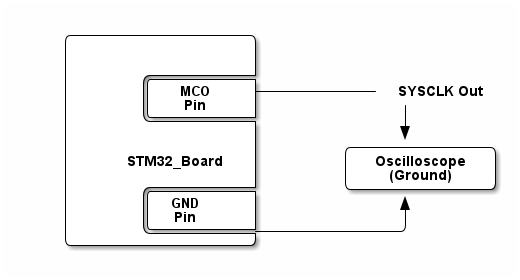

# __Example: *hal_rcc_lse_config*__

**Example version:** 2.0.0

[](https://dev.st.com/stm32cube-docs/examples/arch-v1/en/index.html "An offline version is also available in the STM32Cube firmware package.")

How to configure the LSE (Low Speed External) clock and enable/disable it using the RCC HAL APIs.


## __1. Detailed scenario__

__Initialization phase__: At main program start, the `mx_system_init()` function is called. It initializes the peripherals, nonvolatile memory (such as flash memory, NVM, or external memories), MPU regions (if applicable), the system clock, and the SysTick.

The application executes the following __example steps__:

__Step 1__: The MCO (Microcontroller Clock Output) is configured to output the LSE. The RTC domain
access is granted if necessary to be able to change the LSE state.

__Step 2__: The LSE is disabled during few seconds and then re-enabled.

__Step 3__: The LSE status has been restored to be outputted to the MCO pin.

__End of example__: After step 3, the example terminates. You can check the status LED.

If you enable `USE_TRACE`, you can follow these steps in the terminal logs:
(Here is an example with the NUCLEO-V873XJ, the default LSE frequency may differ for another board)

```text
[INFO] Step 1.1: MCO pin initialized to output the LSE clock.
[INFO] Step 1.2: LSE enabled (32768 Hz) and routed to MCO Pin (MCO freq: 32768 Hz).
[INFO] Step 2: LSE disabled.
[INFO] Step 3: LSE status restored and output on MCO pin.
```

The divider depends on the configuration of the series and so the MCO frequency too.


## __2. Example configuration__

[](https://dev.st.com/stm32cube-docs/examples/arch-v1/en/configure/config_toc.html "An offline version is also available in the STM32Cube firmware package.")

This example demonstrates the following peripheral:

__RCC__:

The example uses the RCC to enable and disable the LSE clock.


## __3. Hardware environment and setup__

### __3.1. Generic Setup__

No specific hardware setup is needed for this example.
Nevertheless, an oscilloscope may also be used to monitor the system clock value on the MCO pin.

<!--
@startditaa doc/example_hal_rcc_lse_config.png
    /------------------\
    |                  |
    |                  |
    |       /----------+
    |       |   MCO    +------------ SYSCLK Out
    |       |   Pin    |              |
    |       \----------+              |
    |                  |              v
    |                  |        /--------------\
    |     STM32_Board  |        | Oscilloscope |
    |                  |        |   (Ground)   |
    |       /----------+        \--------------/
    |       |  GND     |              ^
    |       |  Pin     |              |
    |       \----------+--------------/
    \------------------/
@endditaa
-->



### __3.2. Specific board setups__

This section describes the exact hardware configurations of your project.


<details>
  <summary>On STM32G5 series.</summary>
  <details>
    <summary>On board NUCLEO-G564RE.</summary>

  |  MCU pin  |  Signal name  |  User Label   |
  |:---------:|:-------------:|:-------------:|
  |    PG3    |     GPIO      | MX_STATUS_LED |
  |   PC14    | RCC_OSC32_IN  |       -       |
  |   PC15    | RCC_OSC32_OUT |       -       |
  |    PB9    |   RCC_MCO1    |       -       |
  |    PA2    |   USART2_TX   |       -       |
    <summary>On board NUCLEO-G564RE.</summary>

  </details>
</details>


## __4. Troubleshooting__

[](https://dev.st.com/stm32cube-docs/examples/arch-v1/en/debug/debug_toc.html "An offline version is also available in the STM32Cube firmware package.")

Here are the points of attention for this specific example:

__LSE state__: For some series, LSE is part of the RTC domain and access to it must be granted to modify the LSE state.


## __5. See Also__

[](https://dev.st.com/stm32cube-docs/examples/arch-v1/en/more/more_toc.html "An offline version is also available in the STM32Cube firmware package.")

You can find more information on the reference manual of your chosen MCU on [st.com](https://www.st.com), in the *reset and clock control (RCC)* section.

More information about the STM32Cube Drivers can be found in the drivers' user manual of the STM32 series you are using.

More information about the STM32 ecosystem can be found in the [STM32 MCU Developer Zone](https://www.st.com/content/st_com/en/stm32-mcu-developer-zone/embedded-software.html).


## __6. License__

Copyright (c) 2026 STMicroelectronics.

This software is licensed under terms that can be found in the LICENSE file in the root directory
of this software component.
If no LICENSE file comes with this software, it is provided AS-IS.
