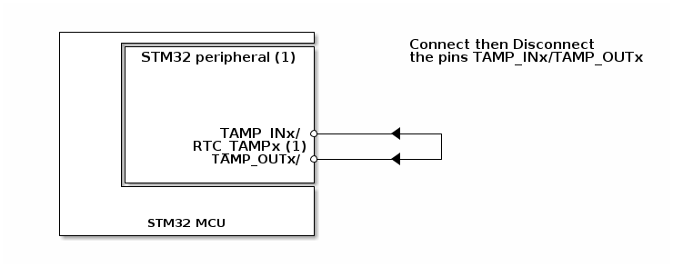

# __Example: *hal_tamp_active_detect*__

**Example version:** 2.0.0

[](https://dev.st.com/stm32cube-docs/examples/arch-v1/en/index.html "An offline version is also available in the STM32Cube firmware package.")

How to automatically erase the backup register when tamper event occurs, using the TAMP HAL APIs.


## __1. Detailed scenario__

__Initialization phase__: At main program start, the `mx_system_init()` function is called. It initializes the peripherals, nonvolatile memory (such as flash memory, NVM, or external memories), MPU regions (if applicable), the system clock, and the SysTick.

The application executes the following __example steps__:

__Step 1__: initializes the peripheral and configures the active tamper (TAMP_OUT/TAMP_IN).

- The backup domain write protection is disabled in tamper init to access to the backup registers.
- Connect externally the TAMP_INx to TAMP_OUTx pins with a wire.

__Step 2__: sets the backup register to the value 0xAAAAAAAA and checks the written data.

__Step 3__: starts the tamper and enables the interruption so that the TAMP continuously compares the pseudorandom output signal with the monitored input.

- Remove the connection of the (TAMP_OUT/TAMP_IN) pins.

__Step 4__: waits for the tamper detection interrupt. It is generated when signal mismatch on the active tamper pair.

__Step 5__: checks that the hardware automatically clears the backup register on tamper detection.

__Step 6__: stops the tamper input and deinitializes the peripheral.

__End of example__: After step 6, the example is completed. You can verify that the example runs properly via the status LED and the `ExecStatus` variable.

If you enable `USE_TRACE`, you can follow these execution steps in the terminal logs:

```text
[INFO] Step 1: Device initialization COMPLETED.
[INFO] Step 2: Backup register 0 WRITTEN.
[INFO] Step 3: Tamper STARTED. Disconnect the pins to generate a tamper detection....
[INFO] Step 4: Signal mismatch. Tamper event DETECTED.
[INFO] Step 5: Backup register 0 CLEARED.
[INFO] Step 6: de-init
...
```


## __2. Example configuration__

[](https://dev.st.com/stm32cube-docs/examples/arch-v1/en/configure/config_toc.html "An offline version is also available in the STM32Cube firmware package.")

This example demonstrates the following peripherals:

__TAMP__:

The tamper is configured in interrupt mode.

- "active tamper" means a continuous comparison between a random signal from a tamper output and the signal input from a tamper input.

The TAMP kernel clock source is the LSI oscillator.

__RCC__:

The backup domain write protection is disabled to access to the TAMP domain and backup registers.


## __3. Hardware environment and setup__

### __3.1. Generic Setup__

This section describes the hardware setup principles that apply to any board.

<!--
@startuml
@startditaa{doc/example_hal_tamp_active_detect.png}
    +---------------------------+
    |      +--------------------+          Connect then Disconnect
    |      |STM32 peripheral (1)|          the pins TAMP_INx/TAMP_OUTx
    |      |                    |
    |      |                    |
    |      |                    |
    |      |                    |
    |      |                    |
    |      |          TAMP_INx/ *--------<----+
    |      |       RTC_TAMPx (1)|             +
    |      |         TAMP_OUTx/ *--------<----+
    |      |                    |
    |      +--------------------+
    |                           |
    |                           |
    |         STM32 MCU         |
    +---------------------------+

@endditaa
@enduml
-->



### __3.2. Specific board setups__

This section describes the exact hardware configurations of your project.

<details>
  <summary>On STM32G5 series.</summary>
  <details>
    <summary>On board NUCLEO-G564RE.</summary>

  |  MCU pin  |  Signal name  |  User Label   |
  |:---------:|:-------------:|:-------------:|
  |    PG3    |     GPIO      | MX_STATUS_LED |
  |    PA2    |   USART2_TX   |       -       |
  |    PA1    |   TAMP_IN2    |       -       |
  |    PB9    |   TAMP_OUT2   |       -       |

  </details>
</details>


## __4. Troubleshooting__

[](https://dev.st.com/stm32cube-docs/examples/arch-v1/en/debug/debug_toc.html "An offline version is also available in the STM32Cube firmware package.")


Here are the points of attention for this specific example:

__Tamper kernel clock__: The TAMP kernel clock is usually the LSI although it is possible to select other clock sources in the RCC. Refer to the RCC chapter in the Reference Manual of your STM32 device for more details.

__Backup domain Power__: The TAMP features and backup registers are part of the backup domain that remains powered-on by VBAT when the VDD power is switched off.

__Reset behavior__: The backup registers are not reset by system reset.
After reset, the backup domains are protected against possible unwanted write accesses. So, you must enable access to the TAMP domain and TAMP registers to configure the TAMP.


## __5. See Also__

[](https://dev.st.com/stm32cube-docs/examples/arch-v1/en/more/more_toc.html "An offline version is also available in the Cube Firmware package.")

The AN4759 application note related to the TAMP features is also available [here.](https://www.st.com/resource/en/application_note/an4759-introduction-to-using-the-hardware-realtime-clock-rtc-and-the-tamper-management-unit-tamp-with-stm32-mcus-stmicroelectronics.pdf)

More information about the STM32Cube Drivers can be found in the drivers' user manual of the STM32 series you are using.

More information about the STM32 ecosystem can be found in the [STM32 MCU Developer Zone](https://www.st.com/content/st_com/en/stm32-mcu-developer-zone/embedded-software.html).


## __6. License__

Copyright (c) 2026 STMicroelectronics.

This software is licensed under terms that can be found in the LICENSE file in the root directory
of this software component.
If no LICENSE file comes with this software, it is provided AS-IS.
