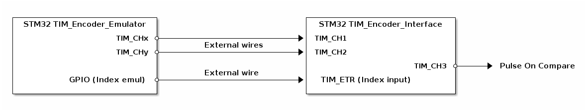
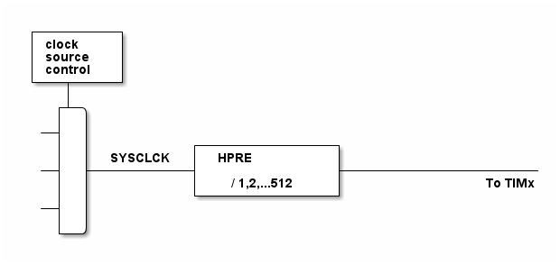

# __Example: *hal_tim_encoder_index_pulse_on_compare*__

**Example version:** 2.0.0

How to configure the TIM peripheral in encoder mode with index, and generate a pulse when the encoder interface counter reaches a compare value (pulse on compare).

## __1. Detailed scenario__

This scenario demonstrates how to configure a timer in encoder mode with an index input, and how to generate a pulse on a channel each time the encoder interface counter matches a compare value (pulse on compare). The index input is used to reset the encoder counter, which prevents the compare match from happening and thus suppresses the pulse on compare.

Two timers are used:

- One timer emulates a quadrature encoder. It generates two phase-shifted signals and an emulated index pulse.
- One timer is configured as the encoder interface. It decodes the quadrature signals, counts up, and outputs a pulse on compare. Its external trigger input (ETR) is used as the index input.

__Initialization phase__: At main program start, the `mx_system_init()` function is called. It initializes the peripherals, nonvolatile memory (such as flash memory, NVM, or external memories), MPU regions (if applicable), the system clock, and the SysTick.

The application executes the following __example steps__:

__Step 1__: Initializes the GPIOs, the timer used to emulate the quadrature encoder, the timer used as the encoder interface, and the user button used to toggle the index emulation.

__Step 2__: Starts both timers. The encoder emulator outputs the two quadrature signals, and the encoder interface starts counting. The pulse-on-compare generator of the encoder interface channel is configured and the channel is started. While the index emulation is inactive, the encoder interface counts up freely and is able to reach the compare value, so a pulse is generated on compare and can be observed on the pulse-on-compare output pin.

__Step 3__: Pressing the user button toggles the index emulation. When the index emulation is active, an index pulse is emitted (on the index emulation pin, wired to the encoder interface ETR input) on each emulator update event. This index pulse resets the encoder interface counter before it reaches the compare value, so the pulse on compare is no longer generated.

__End of example__: The example keeps running. Pressing the user button again deactivates the index emulation, and the pulse on compare reappears.

You can verify that the example runs properly via the status LED and the `ExecStatus` variable.

The encoder signals (CH1/CH2), the index input (ETR), and the pulse on compare can be observed with an oscilloscope. The pulse on compare is present when the index emulation is inactive, and absent when it is active.

## __2. Example configuration__

### __2.1. Timer configuration__

The encoder interface *TIM* is the main timer, configured as follows:

- The timer clock source is configured as encoder mode.
- The encoder mode is set as quadrature encoder x4.
**_NOTE:_** This encoder mode is set to detect both rising and falling edges on both input channels.
- The counter mode is set as up.
- The timer uses two channels set as input capture with direct mode.
**_NOTE:_** On timers, only channel 1 and channel 2 can be used in encoder mode.
- A third channel is configured in pulse-on-compare mode. A pulse is generated on this channel each time the counter reaches the channel compare value.
- The external trigger input (ETR) is configured and the encoder index feature is enabled. An active level on the index input resets the encoder counter.

The encoder emulator *TIM* is a second timer that only generates the signals simulating an encoder output. It is configured as follows:

- The timer channels (say 'x' and 'y') are configured in Output Compare Toggle mode.
- Both channels use the preload on their TIM_CCRx and TIM_CCRy registers.
- The timer prescaler is configured to set the timer counter clock to 1 MHz.
- The toggle frequency is set so that each quadrature signal is a square wave.
- The TIM_CCRx and TIM_CCRy values are set so that one signal is delayed relative to the other by a quarter of the signal period, which corresponds to a 90&deg; phase shift between the two quadrature signals.
- The emulator update event (generated at each counter period) is used to pace the emulated index pulse requests.

Note that the timer configuration depends on the timer peripheral input clock, which is derived from the system clock tree.
So, it is required to define the system clock configuration and to determine the timer input clock before defining the timer configuration.

The system clock configuration is specific to each STM32 MCU (see section [Hardware environment and setup](#3-hardware-environment-and-setup)).

### __2.2. GPIO configuration__

The following pins must be configured: [see the specific boards setups](#32-specific-board-setups)

- Two pins for the two quadrature signals (one per emulator output channel), and two pins for the two encoder interface input channels.
- One pin for the encoder interface external trigger input (ETR), used as the index input.
- One GPIO output pin to emulate the index pulse, wired externally to the ETR input.
- One pin for the pulse-on-compare output channel.
- One pin connected to the user button used to toggle the index emulation.

The timer channel pins are configured in:

- Alternate function as a timer input/output channel of their respective timer instance.
- Push-pull mode with no pull-up or pull-down resistors activated (the ETR index input uses a pull-up).

## __3. Hardware environment and setup__

### __3.1. Generic Setup__

<!--
@startuml
@startditaa{doc/Encoder_index_pulse_on_compare_description.png}

    +----------------------------+                             +-----------------------------+
    | STM32 TIM_Encoder_Emulator |                             | STM32 TIM_Encoder_Interface |
    |                            |                             |                             |
    |                    TIM_CHx *--------------------------+->+ TIM_CH1                     |
    |                            |        External wires       |                             |
    |                    TIM_CHy *--------------------------+->+ TIM_CH2                     |
    |                            |                             |                             |
    |                            |                             |                  TIM_CH3    *----+-> Pulse On Compare
    |                            |        External wire        |                             |
    |          GPIO (Index emul) *--------------------------+->+ TIM_ETR (Index input)       |
    |                            |                             |                             |
    +----------------------------+                             +-----------------------------+
@endditaa
@enduml
-->

The user button toggles the index emulation. While the index emulation is inactive, the pulse on compare is present on the pulse-on-compare output. While the index emulation is active, the encoder interface counter is reset by the index input before reaching the compare value, so the pulse on compare disappears.

### __3.2. Specific board setups__

  
On STM32G5 series.

  

    
Common configuration.

  Timer's counter clock configuration with prescalers set to 1:

  - The timer's internal input clock (tim_ker_ck) is set to the system clock (SYSCLK).

      tim_ker_ck = SYSCLK (system clock)

  To obtain the timer's counter clock frequency (tim_cnt_ck), the timer prescaler register (TIM_PSC) is computed as follows:

      TIM_PSC = (SYSCLK / tim_cnt_ck ) - 1

  Standard STM32G5xx MCUs' peripheral clocks diagram:
<!--
@startuml
@startditaa{doc/stm32g5_peripherals_clocks.png}
 +---------+
 | clock   |
 | source  |
 | control |
 +---+-----+
 |
 ++-\
  |  |
--+  |
  |  |           +---------------+
  |  |  SYSCLCK  |  HPRE         |
--+  +-----------+               +----------------------
  |  |           | / 1,2,...512  |               To TIMx
  |  |           +---------------+
--+  |
  |  |
  +--/
@endditaa
@enduml
-->
  

In this configuration:

- The SYSCLK is set to 280 MHz.
- The HPRE prescaler is set to 1.
- The timer counter clock is set to 1 MHz.

To obtain a timer counter clock at 1 MHz with the HPRE prescaler set to 1 and the SYSCLK set to 280MHz, the timer prescaler must be:

      timer_prescaler = (280 MHz / 1 MHz) - 1 = 279
    

      
Numerical calculations

   The timer's counter clock is set to 1 MHz (see prescaler computation above).

  __Encoder emulator timer:__

  To set the emulator update frequency with a 1 MHz timer counter clock and an auto-reload value (ARR) of 1999:

    update_frequency = tim_cnt_ck / (ARR + 1)
    update_frequency = 1000000 / (1999 + 1) = 500 Hz

  Each output-compare channel toggles once per counter period, so each quadrature signal is a square wave at 250 Hz.

  The delay between the two signals is given by the difference between the two compare registers:

    Delay = (TIM_CCRy - TIM_CCRx) / tim_cnt_ck
    Delay = (1500 - 500) / 1000000 = 1 ms

  This 1 ms delay is a quarter of the 4 ms signal period, which corresponds to a 90&deg; phase shift between the two quadrature signals.

  The emulated index pulse request is paced by the emulator update event. With the repetition counter set to 0, an update event is generated at each counter period:

    index_period = 1 / update_frequency
    index_period = 1 / 500 = 2 ms

  __Encoder interface timer:__

  The encoder interface counter is not clocked by a time base but by the external quadrature signals. In encoder x4 mode, the counter increments 4 times per quadrature signal period, so with 250 Hz signals the counting rate is:

    count_rate = 4 * signal_frequency
    count_rate = 4 * 250 = 1000 counts/s

  The pulse on compare is generated once per counter cycle (auto-reload value ARR of 99), when the counter reaches the channel compare value:

    pulse_on_compare_frequency = count_rate / (ARR + 1)
    pulse_on_compare_frequency = 1000 / (99 + 1) = 10 Hz

  The duration of each pulse is set by the pulse generator, from the pulse width (PW) and the pulse prescaler (PWPRSC). The pulse generator is clocked by the timer kernel clock (tim_ker_ck = SYSCLK = 280 MHz):

    Pulse duration = PW * PWPRSC / tim_ker_ck
    Pulse duration = 255 * 128 / 280000000 = 116.6 us

    

  

  

    
On board NUCLEO-G564RE.

  |  MCU pin  |  Signal name  |  User Label   |
  |:---------:|:-------------:|:-------------:|
  |   PC13    |     GPIO      |   MX_BUTTON   |
  |    PG3    |     GPIO      | MX_STATUS_LED |
  |    PB9    |   TIM8_CH3    |       -       |
  |    PC6    |   TIM8_CH1    |       -       |
  |    PB6    |   TIM8_CH2    |       -       |
  |    PA9    |   TIM8_ETR    |       -       |
  |    PA0    |   TIM2_CH1    |       -       |
  |    PA1    |   TIM2_CH2    |       -       |
  |   PC11    |     GPIO      |       -       |

  The selected timer is TIM8 as encoder interface, with:

  - TIM8_CH1
  - TIM8_CH2
  - TIM8_CH3 for the pulse on compare
  - TIM8_ETR for the index input

  And TIM2 as encoder emulator, with:

  - TIM2_CH1 for channelx
  - TIM2_CH2 for channely  Required external wiring:

  - TIM2_CH1 (PA0) to TIM8_CH1 (PC6).
  - TIM2_CH2 (PA1) to TIM8_CH2 (PB6).
  - GPIO index emulation (PB0) to TIM8_ETR (PA9).

  The pulse on compare can be observed with an oscilloscope on TIM8_CH3 (PB9).

  

## __4. Troubleshooting__

Here are the points of attention for this specific example:

__System clock__: Ensure the system clock is configured correctly to provide accurate timing for the encoder interface and the pulse on compare.

__HAL_Delay()__: Care must be taken when using HAL_Delay(), as it relies on the SysTick interrupt. Ensure the SysTick interrupt has a higher priority than the peripheral interrupt.

__Channels connections__: The connection between the two timers must be respected so the encoder interface decodes the correct encoder signals.

__Index wiring__: The index emulation GPIO must be wired to the encoder interface ETR input. Without this connection, pressing the user button has no effect on the pulse on compare.

## __5. See Also__

You can also refer to these other examples:

- hal_tim_encoder: demonstrates how to use the TIM peripheral in encoder mode to determine the rotation direction.
- hal_tim_pwm_input: demonstrates how to use the TIM peripheral to measure the frequency and duty cycle of a signal.
- hal_tim_oc_toggle: demonstrates how to use the TIM peripheral to generate an output toggling signal.

This [General-purpose timer cookbook for STM32 microcontrollers (ref. AN4776)](https://www.st.com/content/ccc/resource/technical/document/application_note/group0/91/01/84/3f/7c/67/41/3f/DM00236305/files/DM00236305.pdf/jcr:content/translations/en.DM00236305.pdf) provides a simple and clear description of the basic features and operating modes of the STM32 general-purpose timer peripherals.

This [STM32 cross-series timer overview (ref. AN4013)](https://www.st.com/content/ccc/resource/technical/document/application_note/54/0f/67/eb/47/34/45/40/DM00042534.pdf/files/DM00042534.pdf/jcr:content/translations/en.DM00042534.pdf) presents an overview of the timer peripherals for the STM32 product series.

More information about the STM32Cube Drivers can be found in the drivers' user manual of the STM32 series you are using.

For instance for the STM32C5 series: [HAL documentation](https://dev.st.com/stm32cube-docs/stm32c5xx-hal-drivers/latest/en/index.html).

More information about the STM32 ecosystem can be found in the [STM32 MCU Developer Zone](https://www.st.com/content/st_com/en/stm32-mcu-developer-zone/embedded-software.html).

## __6. License__

Copyright (c) 2026 STMicroelectronics.

This software is licensed under terms that can be found in the LICENSE file in the root directory of this software component. If no LICENSE file comes with this software, it is provided AS-IS.
