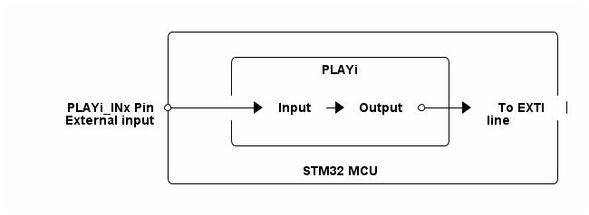

# __Example: *ll_play_wakeup_lowpower*__

**Example version:** 2.0.0

How to configure the PLAY peripheral to wake up the system from low-power STOP mode.

## __1. Detailed scenario__

__Initialization phase__: At main program start, the `mx_system_init()` function is called. It initializes the peripherals, nonvolatile memory (such as flash memory, NVM, or external memories), MPU regions (if applicable), the system clock, and the SysTick.

The application executes the following __example steps__:

__Step 1__: Configures, initializes, and starts the PLAY instance.

__Step 2__: Enters low power STOP mode with WaitForInterrupt parameter.

__Step 3__: The user creates a falling edge on the PLAY input signal.
            This is routed through the PLAY peripheral to the EXTI line, which wakes up the system from low-power STOP mode.
            The system wakes up and turns the status LED on for one second.
            Returns to step 2 indefinitely if no error occurs.

__End of example__: The example runs indefinitely or until an error occurs.

You can verify that the example runs properly via the status LED and the `ExecStatus` variable.

## __2. Example configuration__

The PLAY peripheral is configured to wake up the system from low-power STOP mode when a falling edge is detected on the PLAYi_INx input signal.
The PLAYi_INx input signal is routed with one lookup table (LUT) to the PLAY output connected to the EXTI line, which wakes up the system from low-power STOP mode.

## __3. Hardware environment and setup__

### __3.1. Generic Setup__

This section describes the hardware setup principles that apply to any board.

<!--
@startuml
@startditaa{doc/STMicroelectronics_example_ll_play_wakeup_lowpower.png}
                /------------------------------------------\
                |                                          |
                |      /-----------------------\           |
                |      |         PLAYi         |           |
                |      |                       |           |
                |      |                       |           |
  PLAYi_INx Pin *-------+-> Input -> Output *--+->* To EXTI |
 External input |      |                       |   line    |
                |      |                       |           |
                |      \-----------------------/           |
                |                                          |
                |              STM32 MCU                   |
                \------------------------------------------/
@endditaa
@enduml
-->

### __3.2. Specific board setups__

This section describes the exact hardware configurations of your project.

  
On STM32G5 series.

  

    
On board NUCLEO-G564RE.

  |  MCU pin  |  Signal name  |  User Label   |
  |:---------:|:-------------:|:-------------:|
  |   PC13    |   PLAY1_IN4   |       -       |
  |    PG3    |     GPIO      | MX_STATUS_LED |

  

## __4. Troubleshooting__

Find below the points of attention for this specific example.

__Pins__: Make sure that the user signals are connected to the correct pin of the STM32 MCU.

__Signal stability__: The PLAYi_INx input signal is filtered by the PLAY peripheral by using a minimal pulse width configuration, so it must be stable for a certain number of PLAY clock cycles to be taken into account.

## __5. See Also__

The user manual of the drivers of the relevant STM32 series contains more detailed information.

More information about the STM32 ecosystem can be found in the [STM32 MCU Developer Zone](https://www.st.com/content/st_com/en/stm32-mcu-developer-zone/embedded-software.html).

## __6. License__

Copyright (c) 2026 STMicroelectronics.

This software is licensed under terms that can be found in the LICENSE file in the root directory
of this software component.
If no LICENSE file comes with this software, it is provided AS-IS.
