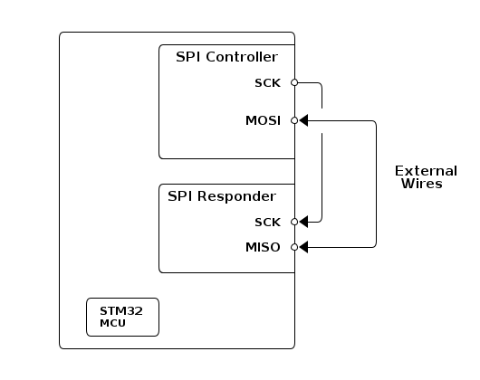

# __Example: *ll_spi_half_duplex_one_board_com_it*__

**Example version:** 2.0.0

How to manage a half-duplex SPI communication on one single board, using the LL API.

## __1. Detailed scenario__

This example uses 2 SPI instances on the same board, one in controller mode and the other in responder mode.

__Initialization phase__: At main program start, the `mx_system_init()` function is called. It initializes the peripherals, nonvolatile memory (such as flash memory, NVM, or external memories), MPU regions (if applicable), the system clock, and the SysTick.

The application executes the following __example steps__:

__Step 1__: configures and initializes the two SPI instances in IT mode.

__Step 2__: the SPI responder side prepares the communication in half-duplex receive mode, using interrupts, waiting for the SPI controller to initiate the communication.

__Step 3__: The SPI controller side initiates the communication in half-duplex transmit mode, using interrupts, by sending data to the SPI responder over the single bidirectional data line. The SPI messages exchanged are null-terminated strings.

__Step 4__: Waits for the transfer complete interruption for both SPI instances, or a transfer error interruption on one of them.

__Step 5__: The SPI controller side prepares the communication in half-duplex receive mode, using interrupts, waiting for the SPI responder to initiate the communication.

__Step 6__: The SPI responder side initiates the communication in half-duplex transmit mode, using interrupts, by sending data to the SPI controller over the single bidirectional data line. The SPI messages exchanged are null-terminated strings.

__Step 7__: Waits for the transfer complete interruption for both SPI instances, or a transfer error interruption on one of them.

__Step 8__: Checks that the sent and received buffers match.

On most boards, the LED shares its pin with the SPI SCK. Therefore, this example does not have a status LED.

__End of example__: While no error occurs, the data is transferred 10 times between the controller and the responder. In case of failure or the maximum number of attempts is reached, the data transfer is stopped and an error status is reported to the `main()` function.

If the data transmit or receive operation fails or the exchanged buffers are different, the controller restarts the communication by sending again the same message. The `error_handler()` function is called when the maximum number of attempts is reached.

## __2. Example configuration__

The example demonstrates the following peripheral:

__SPI__:

The example uses SPI half-duplex synchronous transfers on two lines (MOSI for the controller and MISO for the responder, plus the clock signal). The controller transmits and the responder receives over the single shared data line, in interrupt mode.

- __SPI controller__:
  One first instance is configured as controller, it handles the clock for the transmission
- __SPI responder__:
  One second instance is configured as responder

In addition, it is necessary to set the clock polarity as either LOW or HIGH.
Also configure the clock phase to:

- Either one edge if the first clock transition corresponds to the first data capture edge,
- Or two edges if the second clock transition represents the first data capture edge.

For the current project, the clock polarity is set to LOW, while the clock phase is configured as one edge.

## __3. Hardware environment and setup__

### __3.1. Generic Setup__

This section describes the hardware setup principles that apply to any board.

<!--
@startuml
@startditaa{doc/ASCII_spi_half_duplex_one_board.png} -E -S

    /-------------------------\
    |          /--------------+
    |          |SPI Controller|
    |          |              |
    |          |          SCK *--\
    |          |              |  |
    |          |              |  |
    |          |         MOSI *<-------\
    |          |              |  |     |
    |          |              |  |     |
    |          \--------------+  |     |
    |                         |  |     | External
    |          /--------------+  |     |  Wires
    |          |SPI Responder |  |     |
    |          |              |  |     |
    |          |          SCK *<-/     |
    |          |              |        |
    |          |         MISO *<-------/
    |          |              |
    |          \--------------+
    |                         |
    |  /-------\              |
    |  | STM32 |              |
    |  | MCU   |              |
    |  \-------/              |
    \-------------------------/

@endditaa
@enduml
-->

### __3.2. Specific board setups__

This section describes the exact hardware configurations of your project.

  
On STM32G5 series.

  

    
On board NUCLEO-G564RE.

  |  MCU pin  |  Signal name  |  User Label  |
  |:---------:|:-------------:|:------------:|
  |    PA2    |   USART2_TX   |  DBG_VCP_TX  |
  |    PG3    |   SPI1_SCK    |     PG3      |
  |    PB2    |   SPI1_MOSI   |     PB2      |
  |    PB0    |   SPI3_SCK    |     PB0      |
  |    PB1    |   SPI3_MISO   |     PB1      |

  

## __4. Troubleshooting__

Find below the points of attention for this specific example.

__GPIO speed__: The GPIO slew rate is an important parameter that affects the performance of high-frequency signals. Refer to application note AN4899 in case of issues.
[AN4899](https://www.st.com/resource/en/application_note/an4899-stm32-microcontroller-gpio-hardware-settings-and-lowpower-consumption-stmicroelectronics.pdf)

__LED twinkling__: Most boards have a LED connected to the same pin as SPI SCK from arduino connector. This LED can twinkle during SPI communications.

__Error handling__: In LL examples, error handling is controlled by the USE_LL_APP_ERROR constant in the application files to reduce code footprint. This compilation flag is disabled by default. If the example does not behave as expected, enable error handling for debugging by setting USE_LL_APP_ERROR to 1 in ll_example.h.

## __5. See Also__

[Application Note AN4899](https://www.st.com/resource/en/application_note/an4899-stm32-microcontroller-gpio-hardware-settings-and-lowpower-consumption-stmicroelectronics.pdf): STM32 microcontroller GPIO hardware settings and low-power consumption

You can also refer to these examples to go further with the SPI peripheral:

- ll_spi_full_duplex_two_boards_com_it_controller: full-duplex synchronous SPI communication of the controller with the responder, in interrupt mode.
- ll_spi_full_duplex_two_boards_com_it_responder:  full-duplex synchronous SPI communication of the responder with the controller, in interrupt mode.

More information about the STM32Cube Drivers can be found in the drivers' user manual of the STM32 series you are using.

For instance for the STM32C5 series: [HAL documentation](https://dev.st.com/stm32cube-docs/stm32c5xx-hal-drivers/latest/en/index.html).

More information about the STM32 ecosystem can be found in the [STM32 MCU Developer Zone](https://www.st.com/content/st_com/en/stm32-mcu-developer-zone/embedded-software.html).

## __6. License__

Copyright (c) 2026 STMicroelectronics.

This software is licensed under terms that can be found in the LICENSE file in the root directory
of this software component.
If no LICENSE file comes with this software, it is provided AS-IS.
