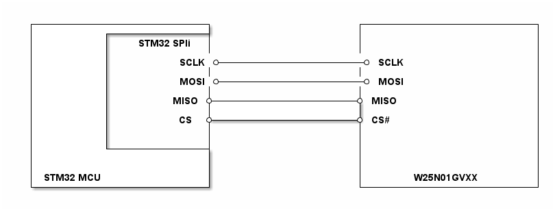

# __Example: *filex_nand_rw_file_no_os*__

**Example version:** 2.0.6

This example demonstrates the use of the **FileX** and **LevelX** stacks in *standalone* mode (no OS) on a **SPI NAND** external memory.

The target external memory is a **Winbond W25N01GVxx** (SPI NAND). The project initializes the memory through the part driver, then FileX:

- opens the `MEDIA_0` media; if opening fails, the media is **formatted** and then re-opened
- creates the `STM32.TXT` file
- writes a test string, closes the file and flushes the media
- re-opens the file for reading, reads it back and checks the content

Execution is considered **OK** when the status LED remains ON. On error, the LED blinks (50 ms ON / 2 s OFF) and the `ExecStatus` variable is set to `EXEC_STATUS_ERROR`.

## __1. Detailed scenario__

__Initialization phase__: At startup, `mx_system_init()` initializes clock, SysTick and peripherals (SPI/GPIO, etc.).

Then the application performs the following steps:

- __Step 1__: initialize FileX (`fx_system_initialize`) and attempt to open the media.
- __Step 2__: if the media is not formatted, **format as FAT** and re-open it.
- __Step 3__: create the `STM32.TXT` file.
- __Step 4__: write data.
- __Step 5__: close + `fx_media_flush`, then re-open and read/validate.
- __Step 6__: close the media.

__End of example__: The example ends by leaving the status LED ON when everything completed successfully. In case of error, the LED blinks (50 ms ON / 2 s OFF) and `ExecStatus` is set to `EXEC_STATUS_ERROR`.

## __2. Example configuration__

### __2.1. NAND memory (W25N01GVxx)__

- The NUCLEO-G564RE uses the LevelX **DMA no OS** driver (`w25n01gvxx_nand_dma_no_os_itf`), with SPI1 TX on GPDMA1 channel 0 and RX on channel 1. SPI1 and both DMA channel interrupts are required. The other boards use **polling** mode.
- The FileX "sector" size is aligned on the NAND **page size** (`W25N01GVXX_DATA_PAGE_SIZE`, typically 2048 bytes). This enables building a FAT filesystem on top of LevelX.

The G564RE checks the NAND JEDEC ID before opening the media and skips formatting when identification fails or no usable blocks are found. DMA does not resolve an incorrect JEDEC response. The optional `nand_diagnostic_only` switch is disabled by default; enabling it stops before FileX writes.

For G564RE regeneration, the transfer mode and SPI DMA requests are configured in the `.ioc2` project, but DMA resource allocations must be resolved in STM32CubeMX2. Confirm TX channel 0, RX channel 1 and all three interrupt handlers after generation.

### __2.2. SPI__

The example uses a board-dependent SPI controller, mode 0 (CPOL=0, CPHA=1st edge), 8-bit, MSB first:

- **NUCLEO-C562RE**: **SPI1**
- **NUCLEO-G564RE**: **SPI1**
- **NUCLEO-V873XJ**: **SPI2**

## __3. Hardware environment and setup__

### __3.1. Generic Setup__

This section describes the hardware setup principles that apply to any board.

<!--
@startuml
@startditaa{doc/w25n01gvxx_generic_hardware_setup.png}
  +-------------------------+                     +-------------------------+
  |          +--------------+                     |                         |
  |          |   STM32 SPIi |                     |                         |
  |          |              |                     |                         |
  |          |          SCLK *---------------------* SCLK                   |
  |          |              |                     |                         |
  |          |          MOSI *---------------------* MOSI                   |
  |          |              |                     |                         |
  |          |         MISO *---------------------* MISO                    |
  |          |              |                     |                         |
  |          |          CS  *---------------------* CS#                     |
  |          |              |                     |                         |
  |          |              |                     |                         |
  |          +--------------+                     |                         |
  |                         |                     |                         |
  |                         |                     |                         |
  | STM32 MCU               |                     |       W25N01GVXX        |
  +-------------------------+                     +-------------------------+
@endditaa
@enduml
-->

### __3.2. Specific board setups__

This section describes the exact hardware configuration of your project.

On STM32G5 series.

  
On board NUCLEO-G564RE.

  With the current generated configuration:

  | MCU pin | Signal name | Notes |
  | :---: | :---: | :--- |
  | PG3 | SPI1_SCK | SCK |
  | PC11 | SPI1_MISO | MISO |
  | PB2 | SPI1_MOSI | MOSI |
  | PB15 | CS# | Software-controlled chip select |

## __4. Troubleshooting__

## __5. See Also__

The documentation of the drivers of the relevant STM32 series contains more detailed information.

## __6. License__

Copyright (c) 2026 STMicroelectronics.

This software is licensed under terms that can be found in the LICENSE file in the root directory
of this software component.
If no LICENSE file comes with this software, it is provided AS-IS.
