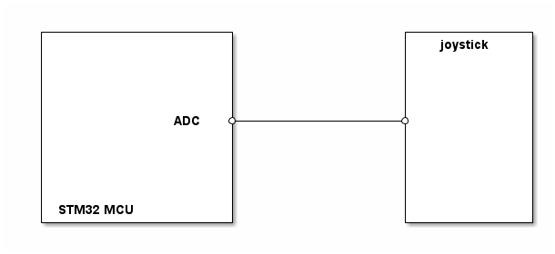

# __Example: *joystick_adc_control*__

**Example version:** 2.0.0

[](https://dev.st.com/stm32cube-docs/examples/arch-v1/en/index.html "An offline version is also available in the Cube firmware package.")

This example demonstrates how to use the joystick part driver to read the key state using the ADC interface in polling mode.


## __1. Detailed scenario__

__Initialization phase__: At main program start, the `mx_system_init()` function is called. It initializes the peripherals, nonvolatile memory (such as flash memory, NVM, or external memories), MPU regions (if applicable), the system clock, and the SysTick.

__Step 1__: Initializes the Joystick instance.

__Step 2__: Read the state of the Joystick key.
            The status LED is toggled when any key is pressed.

__End of example__: The example runs indefinitely in a loop if no errors occur (step 2 is executed in loop).

If you enable `USE_TRACE`, you can follow these execution steps in the terminal logs:

```text
[INFO] Step 1: Device initialization COMPLETED.

[INFO] Step 1: Press any key on the joystick.

[INFO] Step 2: Key Pressed - CENTER
```


## __2. Example configuration__

[](https://dev.st.com/stm32cube-docs/examples/arch-v1/en/configure/config_toc.html "An offline version is also available in the Cube firmware package.")

__JOYSTICK__: Joystick ADC Part Driver

  - The joystick part driver is controlled by an ADC interface. It configures the key min/max values according to the ADC configuration and the hardware setup (resistance values).

__ADC__: The ADC is configured with these specific parameters

  - Single channel conversion.
  - Software trigger.
  - 12 bits resolution.


## __3. Hardware environment and setup__

### __3.1. Generic Setup__

This section describes the hardware setup principles that apply to any board.

Note: Please refer to the "ADC Flavor" section in the joystick part driver README for detailed instructions on how to set up the part.

<!--
@startuml
@startditaa{doc/generic_hardware_setup.png}

  +--------------------+                  +-------------+
  |                    |                  |  joystick   |
  |                    |                  |             |
  |                    |                  |             |
  |                    |                  |             |
  |                    |                  |             |
  |                    |                  |             |
  |              ADC   *------------------*             |
  |                    |                  |             |
  |                    |                  |             |
  |                    |                  |             |
  |                    |                  |             |
  |                    |                  |             |
  |                    |                  |             |
  | STM32 MCU          |                  |             |
  +--------------------+                  +-------------+

@endditaa
@enduml
-->


### __3.2. Specific board setups__

<details>
  <summary>On STM32G5 series.</summary>
  <details>
    <summary>On board B-G564E-DPOW1.</summary>

  |  MCU pin  |  Signal name  |  User Label   |
  |:---------:|:-------------:|:-------------:|
  |    PA5    |     GPIO      | MX_STATUS_LED |
  |   PC15    |   UART5_TX    |       -       |
  |    PA0    |   ADC1_INP1   |       -       |

  </details>
</details>


## __4. Troubleshooting__

[](https://dev.st.com/stm32cube-docs/examples/arch-v1/en/debug/debug_toc.html "An offline version is also available in the Cube firmware package.")

You can also refer to this other example:

- ioe_control: How to use the joystick part IOE API.


## __5. See Also__

[](https://dev.st.com/stm32cube-docs/examples/arch-v1/en/more/more_toc.html "An offline version is also available in the Cube firmware package.")

The documentation of the drivers of the relevant STM32 series contains more detailed information.

More information about the STM32 ecosystem can be found in the [STM32 MCU Developer Zone](https://www.st.com/content/st_com/en/stm32-mcu-developer-zone/embedded-software.html).


## __6. License__

Copyright (c) 2026 STMicroelectronics.

This software is licensed under terms that can be found in the LICENSE file in the root directory
of this software component.
If no LICENSE file comes with this software, it is provided AS-IS.
